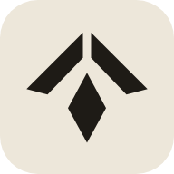
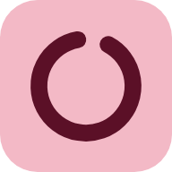

  

<h1 align="center">Oikos</h1>

  <i>οἶκος, household.</i> Your phone and your server, run as one home.

  
  
  
  

  <a href="https://github.com/pharos-hq">Pharos, the sister suite</a> ·
  <a href="https://github.com/Kolbxyz">Kolb</a>

---

Oikos is a suite of self-hosted, privacy-first apps for Android, the terminal and your home server. Everything runs on hardware you own. Nothing phones home: no telemetry, no analytics, no Google services.

Every app works on its own. The music apps can also share one home server, Agro.

## Music

| | App | What it does | Runs on |
|:-:|---|---|---|
|  | **[Agro](https://github.com/oikos-suite/Agro)** | The home server: library sync, Jam rooms, friends and end-to-end encrypted listen-along | Your server (Rust) |
|  | **[Wanda](https://github.com/oikos-suite/Wanda)** | Music player that merges Subsonic servers, local files, YouTube Music and Deezer into one library | Android |
|  | **[Wander](https://github.com/oikos-suite/Wander)** | Music player for the terminal, streaming from Navidrome and Subsonic or playing local files | Terminal (Rust) |
|  | **frwd** | Share links that open a track in Wanda or Wander | Web (not public yet) |

## Phone

| | App | What it does | Runs on |
|:-:|---|---|---|
|  | **[Mono](https://github.com/oikos-suite/Mono)** | A quiet launcher: your apps as one list of names, with no network permission at all | Android |
|  | **[Phalanx](https://github.com/oikos-suite/Phalanx)** | Matrix messaging on the Matrix Rust SDK, end-to-end encrypted, with UnifiedPush | Android |
|  | **Kitsune** | Self-hosted parental control. Your server, your data, encrypted at rest | Your server + Android (not public yet) |

## Shared rules

- **Self-hosted.** There is no Oikos cloud. Where an app needs a server, you run it.
- **No telemetry.** No analytics, no crash reporting, no third-party fonts or scripts.
- **Battery-first.** Built to stay out of your battery stats.
- **Built for hardened phones.** Designed for GrapheneOS, with no Google services.
- **Open source.** EUPL-1.2 unless a repository says otherwise.

---

  Made in France · <a href="https://github.com/pharos-hq">See also: Pharos</a>

